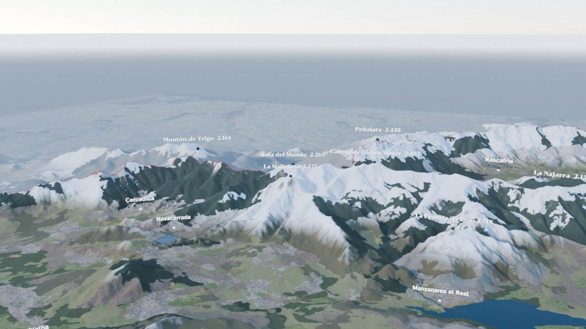
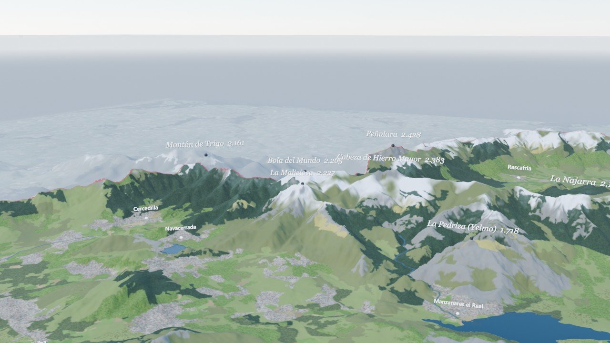
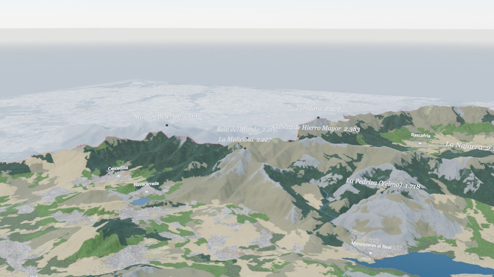
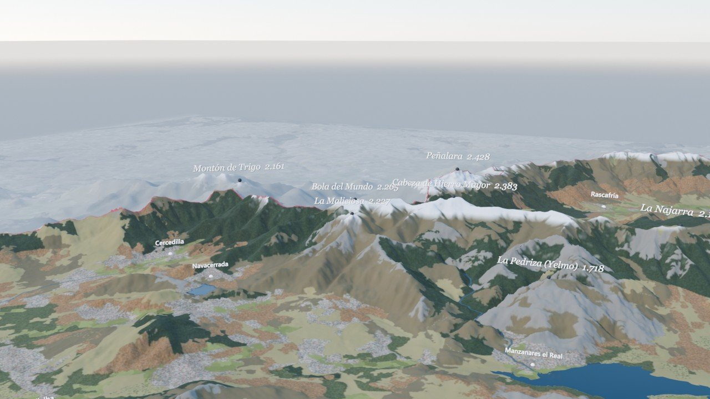

# Madrid en relieve

La Comunidad de Madrid y su sierra en 3D, para Blender y para el navegador. Se puede elegir la estación del año, regular la exageración del relieve y encender o apagar los nombres de picos y pueblos, los ríos, los embalses y el límite de la Comunidad.



| Primavera | Verano | Otoño |
|---|---|---|
|  |  |  |

## Visor web

`web/visor/` es una página autónoma (three.js). Para verla en línea, activá GitHub Pages en este repositorio (Settings › Pages › rama `main`, carpeta raíz) y entrá en `https://<usuario>.github.io/<repositorio>/`. La portada redirige al visor.

En local hace falta un servidor, porque la página carga sus datos con `fetch`:

```
python -m http.server
```

y abrir `http://localhost:8000/web/visor/`.

## Blender

El archivo `.blend` no está en el repositorio porque pesa unos 120 MB. Se genera con los scripts:

1. `python scripts/01_descargar.py`: descarga el relieve del IGN, la ocupación del suelo (CORINE) y las capas de OpenStreetMap a `sources/`. Son unos 85 MB.
2. `powershell -File scripts/rehacer_todo.ps1`: procesa los datos, genera las texturas, arma `blender/madrid3d.blend`, saca los renders de control y exporta el visor web. Si Blender no está en la ruta por defecto, definí antes la variable `BLENDER` con la ruta a `blender.exe`.

Requisitos: Blender 5.2 y Python 3 con `numpy`, `scipy`, `shapely`, `Pillow` y `requests`.

Al abrir el `.blend`, permití la ejecución de scripts (Allow Execution). Con la tecla N aparece el panel **Madrid 3D**: estación, exageración, capas y vistas guardadas. Sin permitir scripts, todo se controla desde las propiedades personalizadas del objeto `CONTROL`.

## Cómo está hecho

- Relieve: MDT de 25 m del IGN, en ETRS89 / UTM 30N. En Blender, 1 unidad equivale a 1 km.
- Color: la ocupación del suelo de CORINE (pinar, rebollar, encinar, dehesa, cereal, matorral, roca, ciudad) se traduce a tonos de foto aérea para cada estación.
- La nieve depende de la altitud, la orientación y la pendiente: aguanta más en las laderas que miran al norte y no se agarra en las paredes.
- Los colores de cada estación y la nieve son una estimación por reglas, no imágenes reales de cada época. El detalle está en `NOTES.md`.

## Estructura

```
scripts/      descarga, procesado, texturas, escena de Blender, renders, visor web
fonts/        Chonburi y Atkinson Hyperlegible (OFL)
web/visor/    visor 3D para el navegador, con sus datos
data/         capas vectoriales procesadas (rótulos, ríos, embalses, límite)
renders/      imágenes de muestra
sources/      registro de fuentes (las descargas no se suben)
NOTES.md      decisiones y supuestos
```

## Fuentes y licencias

- Código: licencia MIT (ver `LICENSE`).
- Relieve: MDT25 © Instituto Geográfico Nacional, CC BY 4.0.
- Ocupación del suelo: CORINE Land Cover, programa Copernicus de la Unión Europea, a través de los servicios del IGN.
- Límite, ríos, embalses, picos y núcleos: © colaboradores de OpenStreetMap, ODbL. `data/capas.json` y `web/visor/datos/capas.json` son bases de datos derivadas y quedan bajo ODbL.
- Límites municipales: recintos municipales © Instituto Geográfico Nacional, CC BY 4.0, en la versión simplificada del paquete `es-atlas`; la textura `web/visor/datos/municipios.png` sale de `scripts/limites_municipales.py`.
- Tipografías: Chonburi (Cadson Demak) y Atkinson Hyperlegible (Braille Institute), SIL Open Font License; sus licencias están en `fonts/`.

Autora: Matilde.
